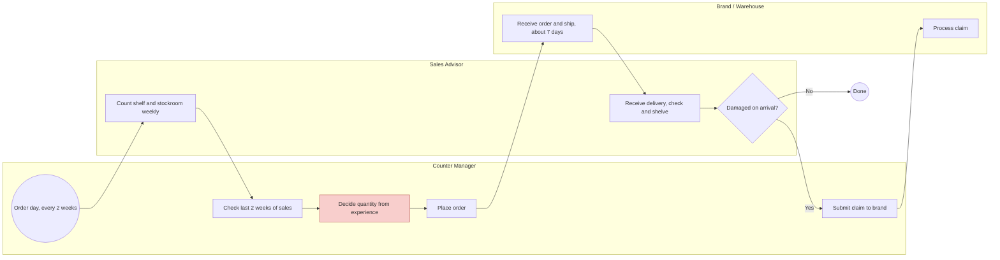
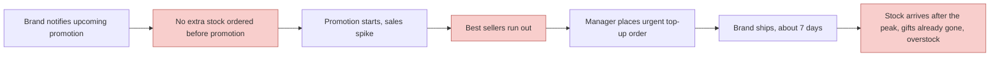

# As-Is Replenishment Process

The editable swimlane diagram is in [`as_is_process.drawio`](as_is_process.drawio). Open it at [app.diagrams.net](https://app.diagrams.net) (File → Open from → Device).

## Regular order cycle

## Promotion

## Pain points

| # | Step | Problem | Effect |
| --- | --- | --- | --- |
| 1 | Decide quantity from experience | Uses last 2 weeks of sales. Stockout weeks look like low demand. | Best sellers get smaller orders and run out again |
| 2 | Decide quantity from experience | The order must cover 21 days (14 until next order plus 7 days delivery), but only 14 days of sales are used | Stock is short before the next delivery |
| 3 | No extra stock before promotion | Promotions are known in advance but not planned into orders | Stockouts in the first days of a promotion, when demand is highest |
| 4 | Urgent top-up order | Takes about 7 days to arrive | Stock arrives after the peak. For GWP, gifts are often gone, so the extra stock sits on the shelf |
| 5 | Weekly stock count | Shrinkage and claims are not linked to ordering | System stock and shelf stock drift apart |

## Open questions and assumptions

| Question | Assumption used in this project |
| --- | --- |
| How often are orders placed? | Every two weeks |
| How long does delivery take? | About 7 days, including urgent orders |
| How far ahead are promotions announced? | At least 21 days |
| Is promotion stock allocated by the brand or ordered with regular stock? | Ordered with regular stock |
| How many gifts per promotion, and who pays for them? | Fixed quantity per promotion, shared across products. Paid by the brand. |
| Are products ordered in full cases? | Yes, case size recorded in `products.case_size` |
